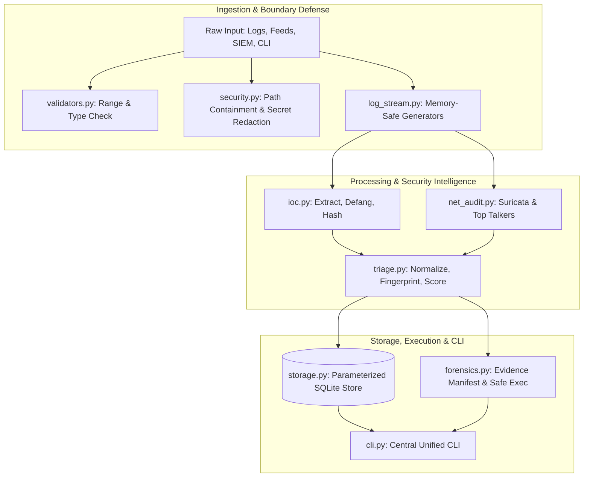
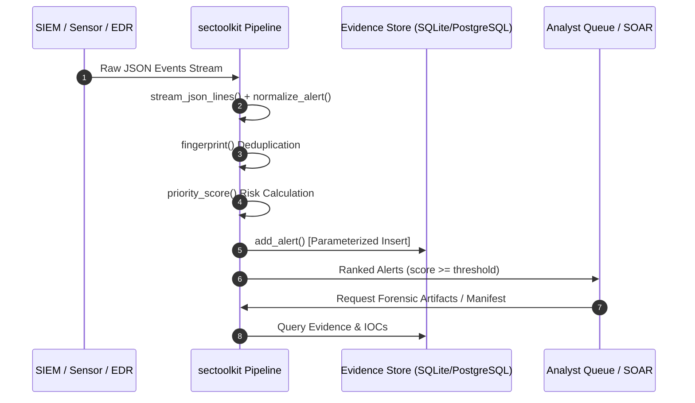

# `sectoolkit`: Security Engineering & SOC Automation Architecture Guide

---

## 1. Executive Summary & Philosophy

The **Security Toolkit (`sectoolkit`)** is a modular, production-grade Python engineering framework built following defensive programming principles from *Python Scripting for Cybersecurity Professionals*.

### Why Python for Security Operations?
Security teams operate in heterogeneous environments where telemetry originates from diverse sources (firewalls, endpoint sensors, network taps, SIEMs, cloud APIs). Python serves as the universal "glue language" of security engineering. However, hastily written scripts often introduce serious vulnerabilities:
- Hardcoded credentials and leaked tokens.
- Command and SQL injection in automation pipelines.
- Memory crashes when reading gigabyte-scale log files.
- Alert fatigue due to lack of deduplication and transparent prioritization.

### Core Defensive Principles Applied
1. **Validate at the Boundaries**: Enforce strict validation (types, ranges, formats) the moment untrusted data enters the application before processing.
2. **Defensive by Default**: Reject `shell=True`, avoid string-concatenated SQL queries, and enforce canonical path containment.
3. **Memory-Conscious Architecture**: Utilize Python generators and iterators (`yield`) to stream data line-by-line rather than reading entire datasets into RAM.
4. **Explainable Prioritization**: Provide transparent mathematical formulas for risk scoring instead of opaque "black-box" heuristics.
5. **Auditable Artifacts**: Maintain cryptographic integrity (SHA-256) and strict ISO 8601 UTC timestamp normalization.

---

## 2. End-to-End System Architecture



---

## 3. Module-by-Module Breakdown

```
src/sectoolkit/
├── validators.py   # Module 1: Input boundary validators
├── security.py     # Module 2: Path containment & secret redaction
├── ioc.py          # Module 3: Threat intelligence & indicator extraction
├── triage.py       # Module 4: SOC triage, deduplication & scoring
├── log_stream.py   # Module 5: Memory-safe log streaming & batching
├── net_audit.py    # Module 6: Network telemetry & Suricata inspection
├── forensics.py    # Module 7: Evidence manifests, timelines & safe exec
├── storage.py      # Module 8: Parameterized SQLite & worker pools
└── cli.py          # Module 9: Central CLI entry point
```

---

### Module 1: Boundary Validators & Normalization
* **File:** [`validators.py`](file:///home/badguy/security-scripts/src/sectoolkit/validators.py)
* **Test Suite:** [`test_validators.py`](file:///home/badguy/security-scripts/tests/test_validators.py) (7 tests)

#### Why We Need It
Security tools consume untrusted network inputs (command-line flags, HTTP headers, syslog lines). If a script accepts an unvalidated port or username, downstream systems can crash, suffer injection attacks, or yield false positive matches.

#### Core Functions
1. `parse_port(value: str | int) -> int`:
   - Enforces that network ports are valid integers in range $[1, 65535]$.
   - Handles type casting gracefully; raises descriptive `ValueError` on non-numeric strings or out-of-range values.
2. `normalize_username(value: str) -> str`:
   - Trims whitespace and applies `casefold()`.
   - *Why `casefold()` over `lower()`?* In international character sets (e.g. German `ß` $\rightarrow$ `ss`), `casefold()` handles aggressive caseless matching, eliminating identity spoofing through unicode trickery.
3. `is_private_ip(ip_text: str) -> bool`:
   - Uses the standard library `ipaddress` module to evaluate IPv4/IPv6 address strings.
   - Accurately identifies RFC 1918 private ranges, loopback (`127.0.0.0/8`), and link-local ranges.

---

### Module 2: Path Traversal & Secret Redaction
* **File:** [`security.py`](file:///home/badguy/security-scripts/src/sectoolkit/security.py)
* **Test Suite:** [`test_security.py`](file:///home/badguy/security-scripts/tests/test_security.py) (5 tests)

#### Why We Need It
- **Directory Traversal**: When analysts supply output paths or filenames, an uncontained path (e.g., `../../etc/shadow`) could allow attackers or faulty scripts to overwrite system files.
- **Credential Leakage**: Logs and diagnostic outputs frequently contain passwords, bearer tokens, and session cookies. Logging these creates severe compliance violations.

#### Core Functions
1. `safe_child(root: Path, user_supplied: str) -> Path`:
   - Resolves absolute canonical paths (`.resolve()`) for both the boundary root and candidate target.
   - Validates that `resolved_root in candidate.parents` or `candidate == resolved_root`.
   - Prevents directory traversal attacks (`../`, symlink attacks) with an explicit `ValueError`.
2. `redact_secrets(data: Any, sensitive_keys: set[str] | None = None) -> Any`:
   - Recursively traverses nested dictionaries, lists, and tuples.
   - Detects keys such as `password`, `token`, `authorization`, `api_key`, `secret`, and `cookie`.
   - Replaces values with `[REDACTED]` while leaving operational metadata intact.

---

### Module 3: Threat Intelligence & IOC Processing
* **File:** [`ioc.py`](file:///home/badguy/security-scripts/src/sectoolkit/ioc.py)
* **Test Suite:** [`test_ioc.py`](file:///home/badguy/security-scripts/tests/test_ioc.py) (4 tests)

#### Why We Need It
Threat intelligence workflows require extracting indicators of compromise (IOCs) from unstructured reports, defanging them to prevent accidental analyst clicks, and calculating file hashes.

#### Core Functions
1. `sha256_file(path: Path | str, chunk_size: int = 1MB) -> str`:
   - Reads files in 1 MB chunks to calculate cryptographic digests without loading multi-gigabyte malware samples into RAM.
2. `extract_iocs(text: str) -> dict[str, list[str]]`:
   - Uses regular expressions to extract candidate IPv4 addresses, SHA-256 hashes (64 hex characters), and MD5 hashes (32 hex characters).
   - Validates IP addresses with `ipaddress.IPv4Address` to reject invalid octets (e.g. `999.999.999.999`).
   - Normalizes hashes to lowercase and deduplicates into sorted lists.
3. `defang_indicator(indicator: str) -> str`:
   - Neutralizes live URLs and IPs for safe sharing: converts `http://` / `https://` into `hxxp://` / `hxxps://` and replaces dots `.` with `[.]`.

---

### Module 4: SOC Triage & Alert Normalization
* **File:** [`triage.py`](file:///home/badguy/security-scripts/src/sectoolkit/triage.py)
* **Test Suite:** [`test_triage.py`](file:///home/badguy/security-scripts/tests/test_triage.py) (8 tests)

#### Why We Need It
SOC analysts are overwhelmed by alert volume. Different SIEMs use conflicting schemas, and brute-force or port scans generate thousands of redundant events.

#### Core Functions
1. `normalize_alert(raw: Mapping) -> dict`:
   - Translates vendor-specific fields (`@timestamp`, `time`, `src_ip`, `rule_name`, `signature`) into a predictable dictionary schema.
2. `fingerprint(alert: Mapping) -> str`:
   - Generates a deterministic SHA-256 hash using sorted JSON keys:
     - `rule`: Alert signature or detection logic.
     - `host`: Target host.
     - `src`: Attacking source IP.
     - `time_bucket`: Timestamp truncated to minute precision (`YYYY-MM-DDTHH:MM`).
   - Alerts with the same signature, attacker, and target within the same minute share an identical fingerprint.
3. `priority_score(severity, confidence, asset_criticality) -> float`:
   - Computes transparent risk prioritization:
     $$\text{Score} = (\text{Severity} \times 0.45) + (\text{Confidence} \times 0.30) + (\text{Criticality} \times 0.25)$$
   - Severity weights: Low=1, Medium=2, High=3, Critical=4. Ratings range from 1.0 to 4.0.
4. `triage_alerts(raw_alerts, ...) -> list[dict]`:
   - Ingests alerts, normalizes fields, aggregates duplicates by fingerprint (incrementing `count`), computes priority scores, filters below `min_priority`, and returns alerts sorted descending by urgency.

---

### Module 5: Large Datasets & Log Streaming
* **File:** [`log_stream.py`](file:///home/badguy/security-scripts/src/sectoolkit/log_stream.py)
* **Test Suite:** [`test_log_stream.py`](file:///home/badguy/security-scripts/tests/test_log_stream.py) (6 tests)

#### Why We Need It
Enterprise firewall and web proxy logs range from 10 GB to several terabytes. Reading a 5 GB log file with `handle.read()` or `handle.readlines()` exhausts server memory and crashes the process.

#### Core Functions
1. `stream_lines(path, needle=None, encoding="utf-8") -> Iterator[tuple[int, str]]`:
   - Opens files with `errors="replace"` to handle corrupted byte sequences gracefully.
   - Yields `(line_number, line_content)` one line at a time via a Python generator, maintaining an $O(1)$ memory footprint.
2. `stream_json_lines(path) -> Iterator[tuple[int, dict]]`:
   - Streams JSON Lines / NDJSON logs (common in modern SIEM and EDR exports).
   - Skips malformed lines safely without aborting the pipeline.
3. `batch_stream(items, batch_size=100) -> Iterator[list]`:
   - Chunks streaming items into bounded batches, enabling bulk database insertions or paginated API requests.

---

### Module 6: Network & Web Telemetry
* **File:** [`net_audit.py`](file:///home/badguy/security-scripts/src/sectoolkit/net_audit.py)
* **Test Suite:** [`test_net_audit.py`](file:///home/badguy/security-scripts/tests/test_net_audit.py) (5 tests)

#### Why We Need It
Security operations require active verification of authorized endpoints, subnet calculations, and parsing network intrusion detection telemetry (Suricata `eve.json` / Zeek `conn.log`).

#### Core Functions
1. `check_tcp(host: str, port: int, timeout: float = 2.0) -> bool`:
   - Audits TCP service availability with socket timeouts to prevent indefinite hanging.
   - Validates port numbers using Module 1's `parse_port`.
2. `subnet_hosts(cidr: str) -> list[str]`:
   - Parses CIDR subnets (e.g. `192.168.1.0/29`) using `ipaddress.ip_network(strict=False)` and extracts all usable host IP addresses.
3. `parse_suricata_eve(path, event_type="alert") -> Iterator[dict]`:
   - Connects to Module 5's `stream_json_lines` to filter Suricata network events on the fly.
4. `summarize_top_talkers(events, key="src_ip", limit=10) -> list[tuple[str, int]]`:
   - Aggregates event volume by key (source IP, destination port, username) using `collections.Counter` to surface anomalies and brute-force sources.

---

### Module 7: Digital Forensics & Safe Execution
* **File:** [`forensics.py`](file:///home/badguy/security-scripts/src/sectoolkit/forensics.py)
* **Test Suite:** [`test_forensics.py`](file:///home/badguy/security-scripts/tests/test_forensics.py) (5 tests)

#### Why We Need It
Forensic integrity demands defensible evidence collection. Evidence must be hashed deterministically, timestamps must be unambiguous, and external tools must be invoked without command injection vulnerabilities.

#### Core Functions
1. `generate_manifest(directory: Path | str) -> list[dict]`:
   - Recursively traverses an evidence directory in deterministic alphabetical order.
   - Generates an immutable manifest capturing relative path, file size in bytes, SHA-256 digest, and collection timestamp in UTC.
2. `verify_manifest(manifest, directory) -> dict[str, list[str]]`:
   - Compares current files against the original manifest.
   - Categorizes findings into `matched` (intact), `modified` (tampered/corrupted), and `missing` (deleted).
3. `parse_iso_timestamp(value: str) -> datetime`:
   - Parses ISO 8601 strings and normalizes them to UTC.
   - Rejects timezone-naive timestamps to prevent correlation errors across disparate sensor clocks.
4. `safe_exec(cmd_args: list[str], timeout: float = 10.0) -> tuple[int, str, str]`:
   - Executes external system utilities (e.g., `tshark`, `nmap`) safely using `subprocess.run(shell=False)` with a list of arguments.
   - Prevents command injection attacks (e.g. `; rm -rf /` or `$(whoami)`).

---

### Module 8: Parameterized SQLite & Concurrency
* **File:** [`storage.py`](file:///home/badguy/security-scripts/src/sectoolkit/storage.py)
* **Test Suite:** [`test_storage.py`](file:///home/badguy/security-scripts/tests/test_storage.py) (4 tests)

#### Why We Need It
Security scripts often require persistent local evidence storage and high-throughput network tasks. String concatenation in SQL statements leads directly to SQL Injection (SQLi), while unconstrained concurrency can trigger denial-of-service on target services.

#### Core Components
1. `EvidenceStore` Class:
   - Encapsulates a local SQLite database with `sqlite3.Row` factory for named column access.
   - **Strict Parameterization**: Queries use `?` placeholders (e.g. `VALUES (?, ?, ?, ?)`), eliminating SQL injection risks.
   - Supports context management (`with EvidenceStore("triage.db") as store:`).
   - Enforces unique fingerprint constraints on alerts to prevent duplicate database entries.
2. `bounded_worker_pool(func, items, max_workers=4) -> list[tuple]`:
   - Uses `concurrent.futures.ThreadPoolExecutor` to execute I/O-bound tasks concurrently.
   - Bounds concurrency to prevent thread exhaustion.
   - Captures per-worker exceptions gracefully without crashing the overall workflow.

---

### Module 9: Central CLI & Packaging
* **File:** [`cli.py`](file:///home/badguy/security-scripts/src/sectoolkit/cli.py) & [`pyproject.toml`](file:///home/badguy/security-scripts/pyproject.toml)
* **Test Suite:** [`test_cli.py`](file:///home/badguy/security-scripts/tests/test_cli.py) (3 tests)

#### Why We Need It
Security analysts need an ergonomic, scriptable terminal interface that integrates all toolkit capabilities into a single binary (`sectoolkit`).

#### CLI Commands
- `sectoolkit triage <alerts.json> [--min-score 2.0]`: Ingests, normalizes, deduplicates, and ranks raw alert batches.
- `sectoolkit manifest <evidence_dir> [-o output.json]`: Generates a cryptographic evidence manifest.
- `sectoolkit ioc "<text_or_file>"`: Parses unstructured threat intel and extracts validated IOCs.
- `sectoolkit audit-port <host> <port> [--timeout 2.0]`: Checks target port accessibility.

#### Packaging Configuration
Standardized `pyproject.toml` configuration enables zero-dependency installation and global CLI registration via pip:
```bash
.venv/bin/pip install --no-build-isolation -e .
```

---

## 4. Verification & Testing Summary

Every capability in `sectoolkit` is backed by automated unit tests covering both the happy path and adversarial edge cases.

```
test_cli_ioc_inline (test_cli.TestCLI) ......................... ok
test_cli_manifest (test_cli.TestCLI) ........................... ok
test_cli_triage (test_cli.TestCLI) ............................. ok
test_generate_and_verify_manifest (test_forensics.TestForensics) ok
test_parse_iso_timestamp (test_forensics.TestForensics) ........ ok
test_parse_iso_timestamp_invalid (test_forensics.TestForensics)  ok
test_safe_exec (test_forensics.TestForensics) .................. ok
test_safe_exec_invalid_args (test_forensics.TestForensics) ..... ok
test_defang_indicator (test_ioc.TestIOC) ....................... ok
test_extract_iocs (test_ioc.TestIOC) ........................... ok
test_sha256_file (test_ioc.TestIOC) ............................ ok
test_sha256_file_missing (test_ioc.TestIOC) .................... ok
test_batch_stream (test_log_stream.TestLogStream) .............. ok
test_batch_stream_invalid_size (test_log_stream.TestLogStream) . ok
test_stream_json_lines (test_log_stream.TestLogStream) ......... ok
test_stream_lines_all (test_log_stream.TestLogStream) .......... ok
test_stream_lines_filter (test_log_stream.TestLogStream) ....... ok
test_stream_lines_missing_file (test_log_stream.TestLogStream) . ok
test_check_tcp_closed (test_net_audit.TestNetAudit) ............ ok
test_check_tcp_invalid_port (test_net_audit.TestNetAudit) ...... ok
test_parse_suricata_eve_and_top_talkers (test_net_audit) ....... ok
test_subnet_hosts (test_net_audit.TestNetAudit) ................ ok
test_subnet_hosts_invalid (test_net_audit.TestNetAudit) ........ ok
test_redact_secrets_nested (test_security.TestSecurity) ........ ok
test_redact_secrets_simple (test_security.TestSecurity) ........ ok
test_safe_child_same_dir (test_security.TestSecurity) .......... ok
test_safe_child_traversal_blocked (test_security.TestSecurity) . ok
test_safe_child_valid (test_security.TestSecurity) ............. ok
test_alert_storage_and_deduplication (test_storage.TestStorage)  ok
test_bounded_worker_pool (test_storage.TestStorage) ............ ok
test_indicator_storage (test_storage.TestStorage) .............. ok
test_indicator_validation (test_storage.TestStorage) ........... ok
test_fingerprint_deterministic (test_triage.TestTriage) ........ ok
test_normalize_alert_alternate_fields (test_triage.TestTriage) . ok
test_normalize_alert_invalid_type (test_triage.TestTriage) ..... ok
test_normalize_alert_standard (test_triage.TestTriage) ......... ok
test_priority_score_invalid_ranges (test_triage.TestTriage) .... ok
test_priority_score_invalid_types (test_triage.TestTriage) ..... ok
test_priority_score_valid (test_triage.TestTriage) ............. ok
test_triage_alerts_pipeline (test_triage.TestTriage) ........... ok
test_is_private_ip (test_validators.TestValidators) ............ ok
test_is_private_ip_invalid (test_validators.TestValidators) .... ok
test_normalize_username (test_validators.TestValidators) ....... ok
test_normalize_username_invalid_type (test_validators) ......... ok
test_parse_port_invalid_range (test_validators.TestValidators) . ok
test_parse_port_invalid_type (test_validators.TestValidators) .. ok
test_parse_port_valid (test_validators.TestValidators) ......... ok
----------------------------------------------------------------------
Ran 47 tests in 0.108s — ALL PASSING (OK)
```

---

## 5. How It Works in Future Operational Deployments



### Operational Use Cases
1. **Automated SOC Ingestion & Triage**:
   - Schedule `sectoolkit triage` via cron or SOAR to ingest hourly alert dumps from Splunk, Elastic, or Microsoft Sentinel.
   - Filter out duplicate noise and route critical alerts ($\ge 3.0$) straight to high-priority analyst queues.
2. **DFIR Evidence Ingestion & Chain of Custody**:
   - Run `sectoolkit manifest /mnt/evidence/drive_image -o manifest.json` immediately upon receiving forensic images.
   - Run `sectoolkit verify_manifest` prior to courtroom testimony or post-incident review to prove data was not altered.
3. **Threat Intel Ingestion Pipeline**:
   - Pipe raw OSINT blogs or CISA advisories into `sectoolkit ioc` to extract indicators, store them in `EvidenceStore`, and defang them for safe analyst review.
4. **Active Perimeter & Internal Audits**:
   - Combine `subnet_hosts` with `bounded_worker_pool(check_tcp, hosts)` to conduct non-intrusive, authorized port reachability checks across enterprise subnets.

---

## 6. Project Files Quick Reference

- **Package Entry Point**: [`__init__.py`](file:///home/badguy/security-scripts/src/sectoolkit/__init__.py)
- **Roadmap & CLI Instructions**: [`README.md`](file:///home/badguy/security-scripts/README.md)
- **Source Modules**:
  - [`validators.py`](file:///home/badguy/security-scripts/src/sectoolkit/validators.py)
  - [`security.py`](file:///home/badguy/security-scripts/src/sectoolkit/security.py)
  - [`ioc.py`](file:///home/badguy/security-scripts/src/sectoolkit/ioc.py)
  - [`triage.py`](file:///home/badguy/security-scripts/src/sectoolkit/triage.py)
  - [`log_stream.py`](file:///home/badguy/security-scripts/src/sectoolkit/log_stream.py)
  - [`net_audit.py`](file:///home/badguy/security-scripts/src/sectoolkit/net_audit.py)
  - [`forensics.py`](file:///home/badguy/security-scripts/src/sectoolkit/forensics.py)
  - [`storage.py`](file:///home/badguy/security-scripts/src/sectoolkit/storage.py)
  - [`cli.py`](file:///home/badguy/security-scripts/src/sectoolkit/cli.py)
